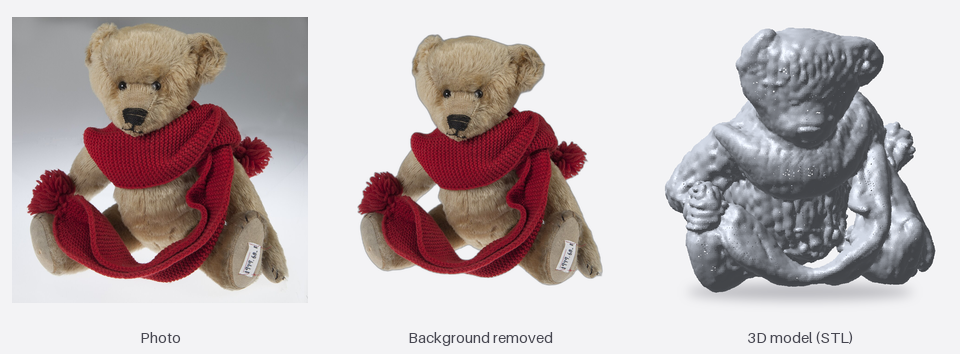
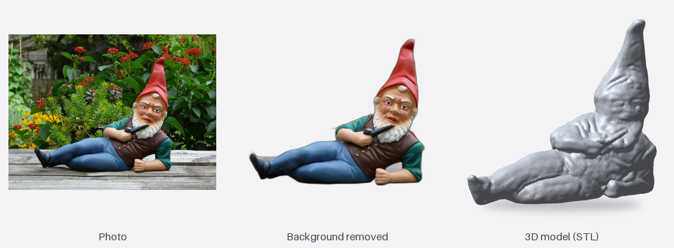

# photo-to-3d

[](https://github.com/sako4018/photo-to-3d/actions/workflows/ci.yml)
[](LICENSE)

🇧🇬 [Версия на български](README.md)

A tool that turns **one photo** of an object into a **print-ready 3D model in STL format**: closed (watertight), in millimetres, with a flat base. It runs entirely on your own computer, with no cloud and no account.

It is for people with a 3D printer who want to turn a photo of a figurine, a toy or a gift into a model for their slicer without learning Blender. The main target is a Mac with Apple Silicon. There is also a Windows version that has not been tried on a real computer yet.




*These two views were made with TripoSR, the previous model. A comparison with TripoSG is in [docs/benchmarks.md](docs/benchmarks.md), section 8 (in Bulgarian). Photos: [Steiff Teddy Bear.jpg](https://commons.wikimedia.org/wiki/File:Steiff_Teddy_Bear.jpg) and [German garden gnome.jpg](https://commons.wikimedia.org/wiki/File:German_garden_gnome.jpg) from Wikimedia Commons, public domain (according to Commons). The 3D view is drawn by `scripts/make_readme_images.py`.*

## What works and what is next

The **command line**, the **local HTTP server** (FastAPI) and the **windowed app** (Electron, `app/`) all work. You give it a photo and get a closed STL, plus a report with the size and the approximate grams of PLA. The AI model is **TripoSG** (about 2 minutes per photo): it gives real detail and correct proportions. The faster but much rougher TripoSR was removed ([decision 007](docs/decisions/007-triposg-only.md), in Bulgarian).

In the app you drop a photo, watch the progress, rotate the model in 3D, change height, base and rotation (without running the AI again), and save the STL or open it in a slicer. With **"Fix a part"** you click a part of the model and smooth it, make it thicker or thinner, or remove it, and you can also type what you want ("smooth it here", "make it 8 cm", "add a base", "try again"). This runs fully inside the app, with no AI and no cloud: the text is understood by rules (Bulgarian, English and Bulgarian in Latin letters), and the fixes are computed on the raw model in about 7–16 s. "Recreate" runs the AI with a new seed, so it gives a different model. Details and what was checked: [app/README.md](app/README.md) (in Bulgarian) and [docs/phase-2-app.md](docs/phase-2-app.md). The plan is in [docs/PLAN.md](docs/PLAN.md) (in Bulgarian).

**Not done yet:** the app is not signed (macOS and Windows warn on the first start), the GitHub release is made by hand (the files are built with `scripts/build-release.sh`), and the Windows version has only been checked in GitHub Actions, not on a real computer.

## How to install

The page in `site/` is at https://sako4018.github.io/photo-to-3d/ (locally: `python3 -m http.server 8791` in the `site/` folder, then http://localhost:8791). It has two download buttons, one for Mac and one for Windows, that download the installer from the latest release (now `v0.0.2`).

1. You download one file: a `.dmg` installer on Mac or an `.exe` on Windows (self-extracting, nothing to unzip).
2. You open it: a window with a status bar. On Windows it first checks the system and the graphics card (`nvidia-smi`) and, if missing, downloads and installs the Microsoft Visual C++ runtime (it checks Microsoft's signature and asks for administrator permission once). Then it downloads the app, checks it (SHA-256) and installs it (Mac: `~/Applications`, Windows: `%LOCALAPPDATA%\Programs`).
3. The same window then prepares the Python environment (PyTorch, about 1 GB on Mac, more on Windows with CUDA). The app brings its own `uv`, so nothing is installed by hand.
4. Last it downloads the AI model (about 7.9 GB) and the small background-removal model (about 176 MB), so the first photo also works offline. If the model download is interrupted the install stays, and the app finishes it on the first start (with Pause/Resume).

If something goes wrong the installer writes a log to `%APPDATA%\photo-to-3d-app\installer.log` (Windows) or `~/Library/Application Support/photo-to-3d-app/installer.log` (Mac).

The download files are built on a Mac with `scripts/build-release.sh [base-url]` into `site/downloads/` (not in git). The script also builds the Windows package from the Windows build of Electron.

## How to run it (macOS)

Once:

```bash
curl -LsSf https://astral.sh/uv/install.sh | sh      # installs uv
cd "$HOME/Desktop/Developer/personal projects/photo-to-3d"
uv run --project engine photo3d install              # downloads the TripoSG model, about 7.9 GB
```

Photo → STL:

```bash
uv run --project engine photo3d make samples/chair.png --height 50
```

Every photo gets its own folder inside `out/`, holding everything about it:

```
out/chair/
  original.png        the photo, copied unchanged
  chair_50mm.stl      the print-ready model
  report.txt          report: closed or not, size, volume, grams of PLA
  details/            the cut-out photo and the raw model (for checking)
```

- The same photo goes to the same folder again (a different height gives a second STL next to the first).
- A different photo with the same name gets a new folder (`chair-2`), so nothing is overwritten.
- `--out FOLDER` changes the place instead of `out/`. `--out file.stl` writes just one STL, with no folder.

Options: `--height` (mm), `--quality fast|normal|detailed`, `--plate MM` (a plate this thick under the model), `--device auto|cpu|mps|cuda`, `--no-remove-bg` (the photo already has its background removed).

**Quality:** `normal` (the default) takes about 2 minutes, `fast` about 1 minute 20 seconds, `detailed` about 3.5 minutes. Comparison and numbers: [docs/benchmarks.md](docs/benchmarks.md), section 8 (in Bulgarian).

At the end the same report is printed: closed or not, size in mm, volume, approximate grams of PLA, time per stage and peak memory.

## Server for the app

```bash
cd "$HOME/Desktop/Developer/personal projects/photo-to-3d/engine"
uv run python -m photo3d_engine --token dev --data-dir "$HOME/photo3d-data"
```

The first printed line is JSON with the real port, for example `{"host": "127.0.0.1", "port": 59782, "token": "dev"}` (`--port 0` is the default and picks a free port). It listens on `127.0.0.1` only and every request needs the `X-Token` header. Projects are kept in `<data-dir>/projects/<id>/`.

```bash
curl -H "X-Token: dev" -d '{"name":"Chair"}' -H 'Content-Type: application/json' http://127.0.0.1:PORT/projects
curl -H "X-Token: dev" -F "photo=@samples/chair.png" http://127.0.0.1:PORT/projects/ID/inputs
curl -H "X-Token: dev" -d '{"project_id":"ID"}' -H 'Content-Type: application/json' http://127.0.0.1:PORT/jobs
```

For the app (Phase 2, [docs/phase-2-app.md](docs/phase-2-app.md), in Bulgarian):

- **Model download:** `POST /engines/triposg/install` starts or resumes the download, `POST /engines/triposg/install/pause` stops it, `GET /engines/triposg/install` gives its state. Progress also comes over the WebSocket as `install` events. The weights go to `<data-dir>/models/triposg/`; a stopped download continues where it stopped. Older weights in the Hugging Face cache count too.
- **`/health`** also gives the free disk space, the graphics (`apple`, `nvidia` or `none`) and the engine for new projects. **`/engines`** gives where the weights are and how much space they take.
- **Jobs** have a `step` (for example `{"done": 12, "total": 20}`) while the model takes its steps.
- **Test mode:** `--engine dummy` makes new projects use the small test engine (no 8 GB download). With `PHOTO3D_DUMMY_SECONDS=10` a job takes 10 s in 5 steps, so the progress screen can be seen.
- **Part fixes:** `POST /projects/{id}/edits` with `{"op": "smooth|thicker|thinner|remove", "point": [x, y, z], "radius_mm": 8}` (the point is in STL millimetres, `amount_mm` and `strength` are optional) applies a fix and rebuilds the STL. `DELETE /projects/{id}/edits/last` undoes it. Fixes are kept in the project settings and cleared by a new generation. `POST /jobs` also takes `seed`.

What is verified: 147 automated tests when the server was added (206 now) (with the `DummyEngine`, no AI model) and a manual run on an M1 Pro with the real TripoSR (the model at the time) and `samples/chair.png`: photo to STL over HTTP with the same report as the command line (82,950 triangles, 28.6 × 27.01 × 50 mm, closed), cancelling a running job, changing the height to 70 mm, export, a path with spaces and Cyrillic, and stopping with SIGTERM. **Not verified:** an Electron app (it does not exist yet), many clients at once, and any other computer. Export is STL only for now.

## Limitations

The numbers come from [docs/benchmarks.md](docs/benchmarks.md), measured on a **MacBook Pro M1 Pro with 16 GB RAM**. Nothing else has been tried.

- **Mainly Apple Silicon.** One computer was tested. Windows was only run on a GitHub Actions runner (installer with a Cyrillic user folder, engine tests, start and stop of the engine with the test model, no graphics card). Intel Macs, NVIDIA, the full model download through the Windows installer and TripoSG on Windows are untested.
- **16 GB of memory is needed.** TripoSG peaks at about 7.5–9.5 GB. On a Mac with 8 GB it will probably not run (not tried).
- **Slow and big:** about 2 minutes per photo and about 7.9 GB download. Tried on 4 photos (chair, watch, sofa, wooden figure). With `detailed`, a few small dots stay on flat areas after simplification.
- **Small details:** the face of an 80 mm figure has its shape, but the features are blurred.
- **Small contact area with the bed.** When an object stands on thin tips, the flat base is small. The report warns about it, and `--plate 2` adds a plate (on the TripoSR chair the contact went from 6.4 to 942.8 mm²).
- **TripoSG is our own rewrite.** Its original code contains parts under Tencent licences that exclude the EU, so the networks were rewritten for the MIT weights (decision 006). The numbers match the original, but the legal side has not been checked by a lawyer.
- **Nothing has been printed.** The STL files open and slice in Bambu Studio, but there has been no real print yet. Validity (closed, correct size in mm) was checked with the trimesh library.
- **Few test photos.** 7 in total: 5 clean renders and 2 real photos of public-domain objects. Bad photos (hard shadows, reflections, transparent objects) have not been tried.
- **The gram estimate is rough**, not a slicer result.
- **Timings (M1 Pro, MPS):** "normal" about 2 min 15 s in total (about 107 s generating and about 25 s loading), "fast" about 80 s, "detailed" about 4 min. Not measured on the CPU.
- **The download is large:** the model is about 7.9 GB and the Python environment (PyTorch) about 1.1 GB.

## Tests

```bash
cd engine
uv run pytest            # fast tests, no AI model
uv run pytest -m slow    # slow tests with the real model (weights must be downloaded)
uv run ruff check .
```

## Documents

- [docs/PLAN.md](docs/PLAN.md): the full plan and roadmap (Bulgarian)
- [app/README.md](app/README.md): the windowed app, how to run it and what it has (Bulgarian)
- [docs/phase-2-app.md](docs/phase-2-app.md): the detailed plan for the windowed app, Phase 2 (Bulgarian)
- [docs/benchmarks.md](docs/benchmarks.md): measurements and findings (Bulgarian)
- [docs/decisions/](docs/decisions/): short explanations of the key decisions (Bulgarian)
- [CONTRIBUTING.md](docs/CONTRIBUTING.md): how to contribute

## Third-party

- **TripoSG** (weights MIT, VAST-AI): the weights are downloaded from Hugging Face (`VAST-AI/TripoSG`). The network code is ours (`engines/triposg_net.py`), not copied from the TripoSG repository, see [decision 006](docs/decisions/006-triposg-own-code.md). The image encoder is DINOv2 (Apache-2.0), loaded with `transformers`.
- **rembg** (MIT): removes the background of the photo.
- Libraries: PyTorch (BSD and Apache-2.0), transformers (Apache-2.0), trimesh (MIT), manifold3d (Apache-2.0), scikit-image (BSD-3-Clause).

The models you make are yours. Be careful with copyright when you photograph other people's figures or characters.

## License

[MIT](LICENSE), Copyright (c) 2026 Sarkis Demirdjian.
